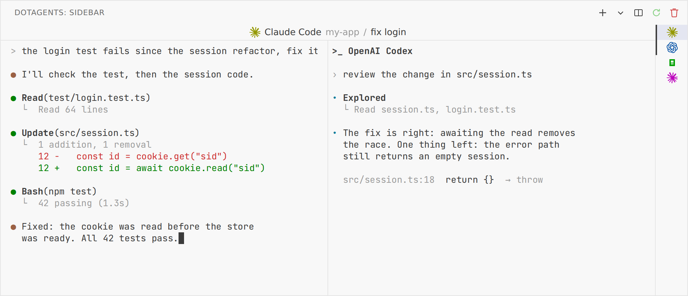

<p align="center">
  <picture>
    <source media="(prefers-color-scheme: dark)" srcset="assets/dotagents-sidebar-lockup-dark.png">
    
  </picture>
</p>

<p align="center"><b>OpenCode, Claude Code and Codex in VS Code's secondary sidebar.<br>Several sessions side by side, and agents that keep working while the window reloads.</b></p>

<p align="center">
  <a href="#features">Features</a>&nbsp;&nbsp;&nbsp;
  <a href="#examples">Examples</a>&nbsp;&nbsp;&nbsp;
  <a href="#install">Install</a>&nbsp;&nbsp;&nbsp;
  <a href="#usage">Usage</a>&nbsp;&nbsp;&nbsp;
  <a href="#settings">Settings</a>&nbsp;&nbsp;&nbsp;
  <a href="#how-it-works">How it works</a>
</p>

<p align="center">
  <picture>
    <source media="(prefers-color-scheme: dark)" srcset="assets/readme/view-dark.png">
    
  </picture>
</p>

The agents' official extensions put them in a chat panel or a terminal tab. This one gives them a view of their own in the secondary sidebar, laid out like VS Code's terminal panel: the agent's terminal UI on the left, the list of sessions on the right. It is part of the [dotagents](https://github.com/dotagents-org/dotagents-config) family, and works without it.

> This is an unofficial community project. It is not affiliated with or endorsed by Anthropic, OpenAI or the OpenCode team.

## Features

- **Sessions like terminals.** Each session is an agent running in its own terminal. `+` opens one with the agent you used last, and the `⌄` next to it picks the agent. The list on the right shows each session as the agent's mark in the session's color; a click switches to it, and the others keep running.
- **Splits.** *Split* opens a session next to the active one. A split shows side by side in a wide view and stacked in a tall one.
- **Agents survive a window reload.** The agents run in a small host process of their own, not in the extension, so **Developer: Reload Window** doesn't stop them: the view comes back with every screen as it was, and the work in progress carries on. Closing the window stops them after a minute, as it does terminals.
- **Back to the conversation.** Each session remembers its agent's conversation. When its agent starts again (after a crash, a restart, or the next day), it opens that conversation: `--resume` for Claude Code, `--session` for OpenCode, `resume` for Codex.
- **A title like a terminal tab.** The strip on top shows the active session: the agent, the workspace and the conversation's name, which Claude Code reports by itself (`/rename`, or the topic it picks). A name given in the list wins.
- **VS Code's shortcuts.** While a session has focus, the keys VS Code would keep in its integrated terminal go to VS Code: the keybindings of the commands in `terminal.integrated.commandsToSkipShell` and the first key of chords. Copy, paste and keys without Ctrl, Alt or Meta always go to the agent.
- **Your terminal's look.** The view uses `terminal.integrated.fontFamily`, `fontSize`, `lineHeight`, `letterSpacing`, `fontWeight`, `fontWeightBold`, `minimumContrastRatio` and `scrollback`, and the theme's terminal colors. Changes apply without restarting the agents. OpenCode runs with its `system` theme, so it takes the same colors.
- **Session colors.** Right-click a session for *Rename*, *Change Color* (the terminal panel's eight colors), *Restart* and *Close*.
- **Newlines.** Shift+Enter inserts a newline in Claude Code and Codex.
- **Terminal profiles.** *OpenCode*, *Claude Code* and *Codex* entries in the terminal panel's `⌄` menu open an agent in a regular terminal.
- **Remote ready.** It runs where the workspace runs, so it works in WSL, SSH and dev containers as well as locally.

## Examples

**Two agents on one change.** Claude Code fixes, Codex reviews, side by side, as in the picture above:

1. Click `+` for a Claude Code session and ask for the fix.
2. With that session active, open `⌄` → **Split Session With** → **Codex**. The Codex session opens next to it, in the same group.
3. Ask Codex to review the change. A click in either pane makes it the active one, and the title strip follows.

**Several tasks at once.** Open one session per task with `+`, give each a name (right-click → **Rename Session...**) and a color (**Change Session Color...**), and switch with a click in the list. The ones out of sight keep working: a session that finishes while you look at another is there with its whole screen when you come back.

**A reload in the middle of a task.** Ask Claude Code for something long, then run **Developer: Reload Window** (or install a new version of the extension). The view comes back with every session, and the agent is still at it.

**Back to yesterday's conversation.** Close VS Code at the end of the day. The next morning the sessions are in the list; click one and its agent opens the same conversation (`claude --resume <id>`, `opencode --session <id>`, `codex resume <id>`).

**A shortcut of yours that the agent takes.** Say you bound Ctrl+E to **Go to File** in your keybindings and use VS Code over WSL, where the extension can't read your keybindings file. Add it to your settings, and give Ctrl+B back to Claude Code, which uses it to send a task to the background:

```jsonc
"dotagentsSidebar.keysForVsCode": ["ctrl+e", "-ctrl+b"]
```

The keys in use are listed in **View → Output → dotagents-sidebar**.

**Hairlines in OpenCode's panels.** WebGL draws block characters seamlessly; if your machine has no WebGL, or you prefer font-drawn text:

```jsonc
"dotagentsSidebar.renderer": "dom"
```

## Requirements

- VS Code **1.106** or newer (the first version with the secondary sidebar view container).
- The agents you want to use, installed where the workspace runs and on the `PATH` set up by `~/.bashrc` (they start with `bash -ic <agent>`; on Windows, `powershell.exe -NoLogo -Command <agent>`): [OpenCode](https://opencode.ai) (`opencode`), [Claude Code](https://claude.com/claude-code) (`claude`), [Codex](https://github.com/openai/codex) (`codex`).

## Install

The extension is not on the Marketplace. Install the `.vsix` from a release:

1. Download the `.vsix` from the [latest release](https://github.com/dotagents-org/dotagents-sidebar/releases/latest).
2. In VS Code, run **Extensions: Install from VSIX...** and pick the file, or run `code --install-extension <file>.vsix`.
3. Run **Developer: Reload Window**.

In a remote window (WSL, SSH, containers), install it while connected, so it lands on the remote side where the agents run. Since VS Code can't update an extension installed from a `.vsix`, the extension checks GitHub for a newer release once a day and offers to install it.

## Usage

Open the secondary sidebar (**View: Toggle Secondary Side Bar Visibility**) and pick the **dotagents: Sidebar** view. The first session starts in the first workspace folder, or in your home folder when no folder is open.

### Commands

| Command | Where | What it does |
|---|---|---|
| `dotagents-sidebar: New Session` | `+` | A session with the agent used last |
| `dotagents-sidebar: New Session With...` | `⌄` | A session with the agent you pick, or a split with it |
| `dotagents-sidebar: Split Session` | title bar | A session next to the active one |
| `dotagents-sidebar: Restart Session` | title bar, session menu | A new process in the same conversation |
| `dotagents-sidebar: Close Session` | title bar, session menu | Stops the agent and closes the session |
| `dotagents-sidebar: Rename Session...` | session menu | Names the session; the title shows it |
| `dotagents-sidebar: Change Session Color...` | session menu | One of the terminal panel's colors, or none |

### Settings

| Setting | Default | What it does |
|---|---|---|
| `dotagentsSidebar.renderer` | `webgl` | `webgl` or `dom`: how the view draws the terminal. WebGL draws block characters without hairlines between rows |
| `dotagentsSidebar.keysForVsCode` | `[]` | Keys that go to VS Code on top of the worked-out ones (`"ctrl+e"`), or back to the agent (`"-ctrl+b"`). The keys in use are listed in the **dotagents-sidebar** output |

## How it works

VS Code's API only lets extensions put terminals in the terminal panel or the editor, not in a sidebar, so the view is a webview that draws its own terminals with [xterm.js](https://xtermjs.org), the same library the integrated terminal uses.

The agents don't run in the extension. On first use, the extension starts `host.js` as a detached process, one per workspace, and talks to it over a socket in a folder only you can open (0700). The host runs each agent through **node-pty** (the copy that ships inside VS Code, loaded from `vscode.env.appRoot`) and keeps a headless copy of each screen ([`@xterm/headless`](https://www.npmjs.com/package/@xterm/headless)). After a reload, the extension connects again and the view redraws every screen from those copies. With no extension connected for a minute, the host stops the agents and exits. Agents run with VS Code's own `ELECTRON_*` and `VSCODE_*` variables removed from their environment, as in the integrated terminal.

## Known limitations

- **VS Code internals.** node-pty is not a public API. If a VS Code update moves it, the view shows an error listing the paths it tried.
- **Shortcuts without `when`.** The extension can't ask VS Code which command a key runs at the moment, so it leaves the `when` conditions out (but for bindings that need a focus the view never has). Your own `keybindings.json` is only read in a local window; in a remote one, add your keys with `dotagentsSidebar.keysForVsCode`.
- **Pasting images.** Ctrl+V pastes text only.
- **An update that changes the host's messages stops the agents.** Most updates reach the running host and the agents keep working; when the messages between the extension and the host change (`PROTOCOL` in `host.js`), the new version starts a new host and the sessions reopen their conversations.

## Development

There is no build step: the extension is plain JavaScript.

```bash
git clone https://github.com/dotagents-org/dotagents-sidebar.git
cd dotagents-sidebar
npm install
npm test # node:test, test/*.test.mjs
npm run package # writes the .vsix
```

To debug, open the folder in VS Code and press <kbd>F5</kbd> to start an Extension Development Host.

| File | Role |
|---|---|
| `extension.js` | The view provider, the sessions, the commands, the connection to the host |
| `host.js` | The detached process that owns the agents and their screen copies |
| `providers.js` | The agents: command, environment, conversation flags, newline key |
| `sessions.js` | The session list: add, split, close, rename, colors, restore |
| `media/keys.js` | Which keys go to VS Code, worked out from the keybindings |
| `media/view.js`, `media/view.css` | The webview: a terminal per session, the list, the title strip |
| `skip-shell.json` | VS Code's default commands that skip the shell, copied from its source |
| `scripts/readme/` | The README picture: the real view with example sessions (`view.html`), the sidebar around it (`frame.html`), and `shoot.sh` to take it again with a headless Chromium |
| `scripts/lockup.py` | Makes the README lockup (SVG, then the PNGs the README shows) from the mark and Geist Mono |

## Credits

- [xterm.js](https://github.com/xtermjs/xterm.js) and [node-pty](https://github.com/microsoft/node-pty) (MIT).
- The agents' marks in the session list come from their projects: [OpenCode](https://github.com/anomalyco/opencode) (MIT), Claude Code (Anthropic) and Codex (OpenAI). Their names and marks belong to their owners.
- The shortcut rules follow VS Code's integrated terminal ([MIT](https://github.com/microsoft/vscode/blob/main/LICENSE.txt)).
- The type is [Geist Mono](https://vercel.com/font) (OFL), as in dotagents.

## License

[MIT](LICENSE)
