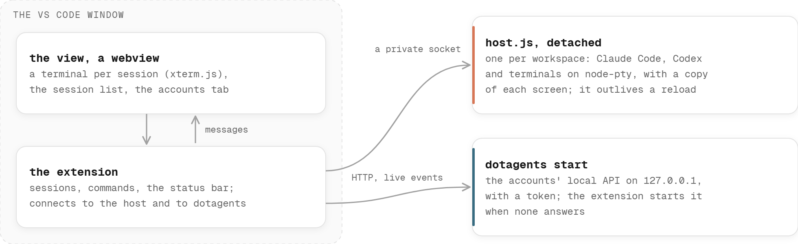
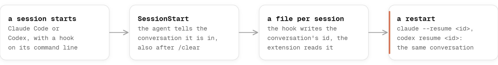
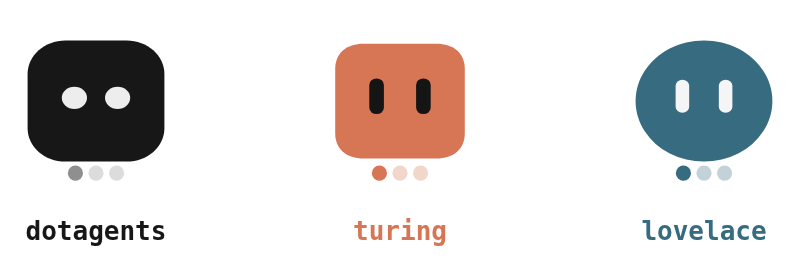
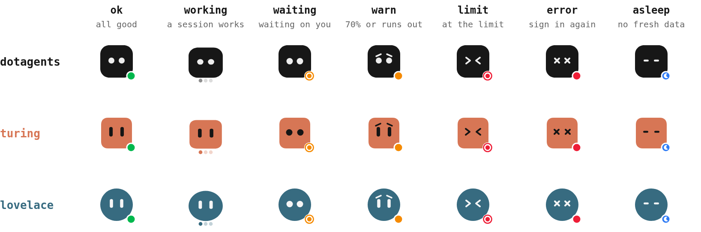

  <picture>
    <source media="(prefers-color-scheme: dark)" srcset="assets/dotagents-sidebar-lockup-dark.png">
    
  </picture>

<b>Claude Code and Codex in VS Code's secondary sidebar. Your Claude and ChatGPT accounts beside it, live, a click away from switching.</b>

  <a href="#features">Features</a>&nbsp;&nbsp;&nbsp;
  <a href="#how-it-works">How it works</a>&nbsp;&nbsp;&nbsp;
  <a href="#quick-start">Quick start</a>&nbsp;&nbsp;&nbsp;
  <a href="docs/README.md">Documentation</a>&nbsp;&nbsp;&nbsp;
  <a href="CHANGELOG.md">Changelog</a>

  
  
  
  
  

> [!NOTE]
> **An unofficial community project**, not affiliated with or endorsed by Anthropic or OpenAI. It runs Claude Code and Codex.

The official Claude Code and Codex extensions put the agent in a chat panel or a terminal tab. This extension gives each one a view of its own in the secondary sidebar, laid out like VS Code's terminal panel: the agent's terminal on the left, the session list on the right. The agents keep working while the window reloads.

With [dotagents](https://github.com/dotagents-org/dotagents-core) set up, the view also shows your Claude and ChatGPT accounts: their usage and state in the first tab, the current one in the status bar, and the switch. Without dotagents you get the sessions only.

## Features

**Sessions**

- **Sessions like terminals.** Each session is an agent in its own terminal. The Claude Code and Codex buttons open one, and the list moves between them while the others keep running.
- **Splits.** Right, left, down or up, nested, with a divider you can drag, and Claude Code, Codex or a terminal in the new pane; grouped in the list the way the terminal panel groups its tabs. Drag a session to reorder it, along with its split. Hold Shift to drop it on another session and join that split, or below the last one to leave its split.
- **Agents survive a reload.** They run in a small host process of their own, so **Developer: Reload Window** brings back every screen as it was.
- **Back to the right conversation.** A session that starts again (after a crash, a restart, the next day) reopens its conversation with `--resume`, or `codex resume` for Codex. The agent reports which conversation it is in through a `SessionStart` hook passed on its command line, so the restart follows a `/clear` or `/resume` typed inside it.
- **Like the integrated terminal.** Your terminal font and colors, VS Code's shortcuts while a session has focus, copy and paste, file paths you can click, Shift+Enter for a newline, and a name and color per session.

**Your Claude and ChatGPT accounts, with dotagents**

- **The accounts tab.** Every account with its plan, its 5-hour, weekly and per-model windows, the projection to the reset, and a switch that applies to both sides of the machine and then says what to do with the sessions already open.
- **Avatars that show the state.** Each account has its own color and shape. The eyes and the corner dot give its state, and it hops while a session works.
- **The status bar.** One group per provider, with its current account and usage; a click opens the switch.

**Everywhere**

- **Remote ready.** It runs where the workspace runs: locally, in WSL, over SSH and in dev containers.

## How it works

VS Code doesn't let an extension put terminals in a sidebar, so the view is a webview that draws its own, with [xterm.js](https://xtermjs.org). The agents don't run in the extension: a detached host process, one per workspace, runs them and keeps a copy of each screen, so a reload or an update only reconnects to it. The accounts come from `dotagents start`, dotagents' local API on 127.0.0.1, which the extension starts when none answers.

  <picture>
    <source media="(prefers-color-scheme: dark)" srcset="assets/readme/how-it-works-dark.png">
    
  </picture>

### Back to the right conversation

Each session starts its agent with a `SessionStart` hook on the command line, never in your settings. The hook writes the conversation's id to a file the extension reads, and a restart resumes that id.

  <picture>
    <source media="(prefers-color-scheme: dark)" srcset="assets/readme/resume-dark.png">
    
  </picture>

Codex reports a new conversation only at its first message. A restart right after `/resume` in Codex, before you send anything, opens the conversation from before.

More in [Architecture](docs/architecture.md).

### The accounts

  <picture>
    <source media="(prefers-color-scheme: dark)" srcset="assets/readme/avatars-dark.png">
    
  </picture>

The eyes and the corner dot show each account's state:

  <picture>
    <source media="(prefers-color-scheme: dark)" srcset="assets/readme/states-dark.png">
    
  </picture>

## Quick start

You need VS Code 1.106 or later, and [Claude Code](https://claude.com/claude-code) or [Codex](https://developers.openai.com/codex/cli) on the `PATH` where the workspace runs.

1. In a clone of this repository, run `npm install`, then `npm run package`. It writes `dotagents-sidebar.vsix`.
2. Run **Extensions: Install from VSIX...** (in a remote window, while connected), then **Developer: Reload Window**.
3. Open the secondary sidebar and pick **dotagents: Sidebar**. The Claude Code or Codex button starts a session.

For the accounts, set up [dotagents](https://github.com/dotagents-org/dotagents-core#quick-start) on the same side and add your profiles; the tab appears after the next reload. More in [Getting started](docs/getting-started.md).

## Documentation

- [Getting started](docs/getting-started.md): requirements, installing, the first session, updates.
- [Sessions](docs/sessions.md): sessions and splits, the conversation, keys, commands and settings.
- [Accounts](docs/accounts.md): the accounts tab, the avatars, the status bar, and how the view finds dotagents.
- [Architecture and development](docs/architecture.md): the webview and the host, the files, tests, releases.
- [Troubleshooting and limits](docs/troubleshooting.md).

## Contributing

Issues and pull requests are welcome. There is no build step: `npm install`, `npm test` (`node:test`) before a pull request, `npm run package` for the `.vsix`; details in [Architecture and development](docs/architecture.md#development). Commits are one line in English, gitmoji plus [Conventional Commits](https://www.conventionalcommits.org/) (`✨ feat: …`).

## The family

- **[dotagents-core](https://github.com/dotagents-org/dotagents-core)**: the `dotagents` command, the workspace standards, and the logic of the Claude and ChatGPT accounts, with the local API (`dotagents start`).
- **dotagents-config**: your configuration, a repository of your own next to dotagents-core.
- **dotagents-sidebar**, this repository: Claude Code, Codex and your Claude and ChatGPT accounts in VS Code's secondary sidebar.

## Credits

- [xterm.js](https://github.com/xtermjs/xterm.js) and [node-pty](https://github.com/microsoft/node-pty) (MIT).
- The Claude Code mark in the session list is Anthropic's, and the Codex mark OpenAI's; each belongs to its owner.
- The shortcut rules follow VS Code's integrated terminal ([MIT](https://github.com/microsoft/vscode/blob/main/LICENSE.txt)).
- The type is [Geist Mono](https://vercel.com/font) (OFL), as in dotagents.

## License

[MIT](LICENSE)
