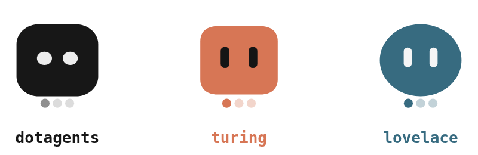
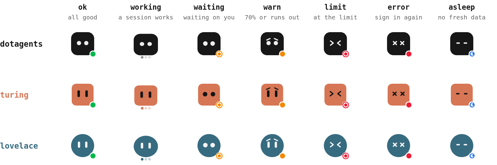

  <picture>
    <source media="(prefers-color-scheme: dark)" srcset="assets/dotagents-sidebar-lockup-dark.png">
    
  </picture>

<b>Claude Code in VS Code's secondary sidebar. Your Claude accounts beside it, live, a click away from switching.</b>

  <a href="#features">Features</a>&nbsp;&nbsp;&nbsp;
  <a href="#how-it-works">How it works</a>&nbsp;&nbsp;&nbsp;
  <a href="#quick-start">Quick start</a>&nbsp;&nbsp;&nbsp;
  <a href="docs/README.md">Documentation</a>&nbsp;&nbsp;&nbsp;
  <a href="https://github.com/dotagents-org/dotagents-sidebar/releases">Releases</a>

  
  
  
  

> [!NOTE]
> **An unofficial community project**, not affiliated with or endorsed by Anthropic. It offers Claude Code only for now: OpenCode and Codex are switched off, and their support stays in the code.

Claude Code's official extension puts it in a chat panel or a terminal tab. This one gives it a view of its own in the secondary sidebar, laid out like VS Code's terminal panel: the agent's terminal UI on the left, the list of sessions on the right, and the agents keep working while the window reloads.

With [dotagents](https://github.com/dotagents-org/dotagents-core), it is also where your Claude accounts live in VS Code: the first tab shows every account's usage, its state as an avatar, and the switch; the status bar shows the current one. It works without dotagents, with the sessions only.

## Features

**Sessions**

- **Sessions like terminals.** Each session is an agent in its own terminal; `+` opens one, and the list switches between them while the others keep running.
- **Splits.** Side by side in a wide view, stacked in a tall one.
- **Agents survive a reload.** They run in a small host process of their own, so **Developer: Reload Window** brings the view back with every screen as it was.
- **Back to the conversation.** A session that starts again (a crash, a restart, the next day) opens its conversation with `--resume`.
- **Like the integrated terminal.** Your terminal font and colors, VS Code's shortcuts while a session has focus, Shift+Enter for a newline, names and colors per session.

**Your Claude accounts, with dotagents**

- **The accounts tab.** Every account with its 5-hour, weekly and model windows, the projection to the reset, and a switch that puts it on both sides of the machine.
- **Avatars that say how it is.** Each account in its color and shape; the eyes and the dot in the corner give its state, and a session at work makes it hop.
- **The status bar.** The current account and its usage as in the statusLine; a click switches.

**Everywhere**

- **Remote ready.** It runs where the workspace runs: locally, in WSL, over SSH and in dev containers.

## How it works

The view is a webview with its own terminals ([xterm.js](https://xtermjs.org)), since VS Code doesn't let an extension put terminals in a sidebar. The agents run in a detached host process, one per workspace, that keeps each screen, so a reload or an update only reconnects to it. The accounts come from `dotagents start`, dotagents' local API on 127.0.0.1, which the view starts when none answers. More in [Architecture](docs/architecture.md).

### The accounts

  <picture>
    <source media="(prefers-color-scheme: dark)" srcset="assets/readme/avatars-dark.png">
    
  </picture>

The eyes and the dot in the corner say how each account is:

  <picture>
    <source media="(prefers-color-scheme: dark)" srcset="assets/readme/states-dark.png">
    
  </picture>

## Quick start

You need VS Code 1.106+ and [Claude Code](https://claude.com/claude-code) on the `PATH` where the workspace runs.

1. Download `dotagents-sidebar.vsix` from the [latest release](https://github.com/dotagents-org/dotagents-sidebar/releases/latest).
2. Run **Extensions: Install from VSIX...** (in a remote window, while connected), then **Developer: Reload Window**.
3. Open the secondary sidebar and pick **dotagents: Sidebar**; `+` starts a session.

For the accounts, set up [dotagents](https://github.com/dotagents-org/dotagents-core#quick-start) on the same side and add your profiles; the tab appears on the next reload. More in [Getting started](docs/getting-started.md).

## Documentation

- [Getting started](docs/getting-started.md): requirements, installing, the first session, updates.
- [Sessions](docs/sessions.md): sessions and splits, the conversation, keys, commands and settings.
- [Accounts](docs/accounts.md): the accounts tab, the avatars, the status bar, and how the view finds dotagents.
- [Architecture and development](docs/architecture.md): the webview and the host, the files, tests, releases.
- [Troubleshooting and limits](docs/troubleshooting.md).

## Contributing

Issues and pull requests are welcome. There is no build step: `npm install`, `npm test` (`node:test`) before a pull request, `npm run package` for the `.vsix`; details in [Architecture and development](docs/architecture.md#development). Commits are one line in English, gitmoji plus [Conventional Commits](https://www.conventionalcommits.org/) (`✨ feat: …`).

## The family

- **[dotagents-core](https://github.com/dotagents-org/dotagents-core)**: the `dotagents` command, the workspace standards, and the logic of the Claude accounts, with the local API (`dotagents start`).
- **dotagents-config**: your configuration, a repository of your own next to dotagents-core.
- **dotagents-sidebar**, this repository: Claude Code and your Claude accounts in VS Code's secondary sidebar.

## Credits

- [xterm.js](https://github.com/xtermjs/xterm.js) and [node-pty](https://github.com/microsoft/node-pty) (MIT).
- The agents' marks in the session list come from their projects: Claude Code (Anthropic), [OpenCode](https://github.com/anomalyco/opencode) (MIT) and Codex (OpenAI). Their names and marks belong to their owners.
- The shortcut rules follow VS Code's integrated terminal ([MIT](https://github.com/microsoft/vscode/blob/main/LICENSE.txt)).
- The type is [Geist Mono](https://vercel.com/font) (OFL), as in dotagents.

## License

[MIT](LICENSE)
